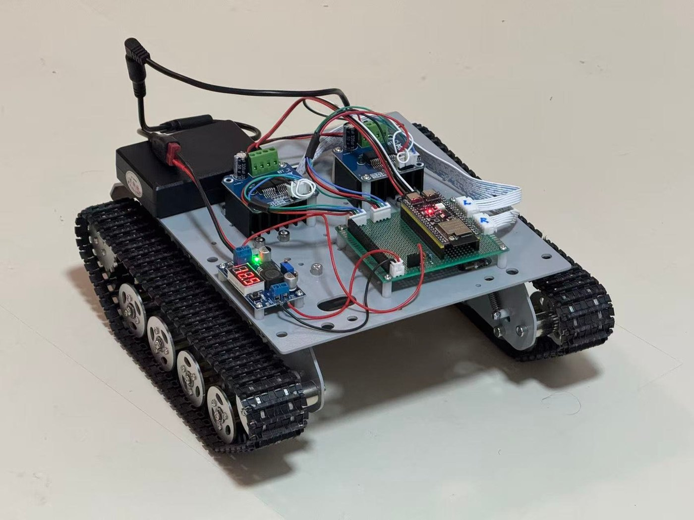
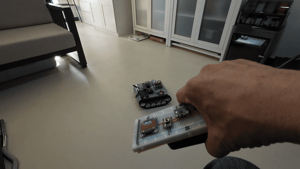

# 张曦的硬件小项目

业余时间折腾 ESP32、3D 打印和机械结构。这里是我的存档——每个仓库都是能跑起来的东西，
带完整文档、踩过的坑和版本标签。

手持板一倾，车就跟着走（没插遥控器时由板上的 MPU6050 接管）：

## 在做的东西

| 项目 | 是什么 | 状态 |
|---|---|---|
| **[tracked-car](https://github.com/zhangsino/tracked-car)** | ESP32-S3 履带车：编码器闭环直行 + ESP-NOW 无线遥控 | 能跑 |
| **[esp-now-joystick](https://github.com/zhangsino/esp-now-joystick)** | 大疆 RC2 插在 ESP32 上（USB Host），摇杆数据走 ESP-NOW 发出去 | 能跑 |
| **[two-axis-gimbal](https://github.com/zhangsino/two-axis-gimbal)** | 两轴自调平云台：模型 + 固件 + 舵机/IMU 测试 | 已完成 |
| **[esp32-lab](https://github.com/zhangsino/esp32-lab)** | 零散实验：倾角、触摸、麦克风阵列、网页 HMI | 进行中 |

## 手艺

`ESP-IDF` · `C` · `MicroPython` · `SolidCraft` · `Bambu P2S` · `焊接与走线`

每个仓库里都有 `项目状态.md`，写的是"现在能做到什么、接线怎么接、哪些坑踩过"——
因为我自己三个月后也会忘。
